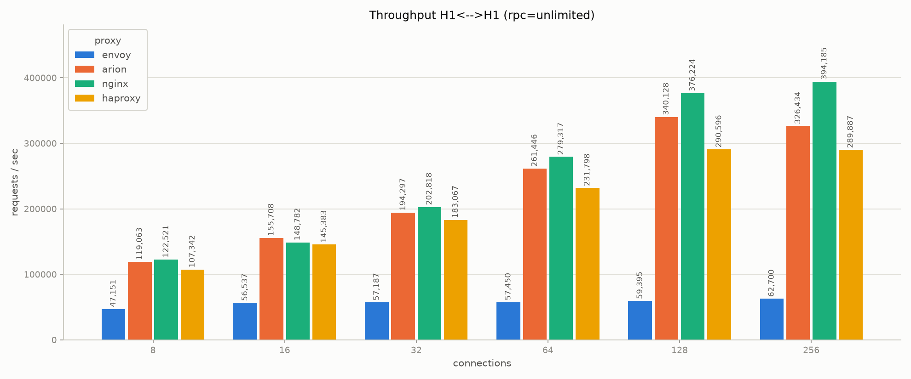
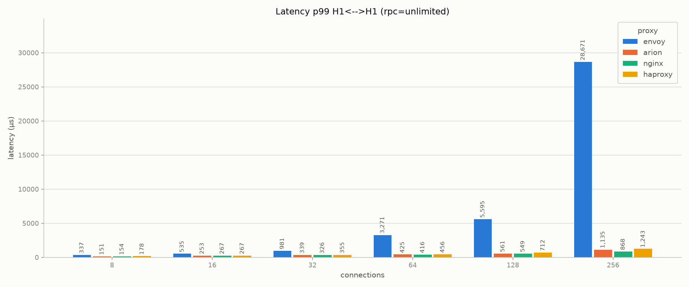

# baseline-small-scale

The same `h1_h1` scenario of the [baseline](baseline.md) (HTTP/1.1 ->
HTTP/1.1, empty GET requests, fixed 200 response from the backend), but the
proxy has only 4 cores instead of 32. The idea is to see how the proxies
behave when the CPU is very limited, like in a small container or a
sidecar. For the environment see [testbed](testbed.md).

We test four proxies: arion, nginx, haproxy and envoy (agentgateway was not
part of this family). The proxy is pinned on `1-7:2` (4 CPUs of NUMA1) with
4 workers/threads. Also the IRQs of the NUMA1 NIC are pinned on the same 4
CPUs, so the proxy and the network interrupts share the same cores, like in
a real environment with few resources. This is not part of the sweep
configs: to reproduce the tests, the IRQ affinity of the NIC queues must be
set manually to CPUs 1, 3, 5 and 7. Generator and backend are on NUMA0, without overlap: the
generator on `16-38:2` and the backend on `40-62:2`, both with 12 threads.
One run of 30s for each point, rpc in {1, unlimited} and concurrency in
{8, 16, 32, 64, 128, 256}.

## Throughput

rps with `rpc: unlimited`:

| proxy | @8 | @16 | @32 | @64 | @128 | @256 |
|---|---|---|---|---|---|---|
| nginx | 122,521 | 148,782 | 202,818 | 279,317 | 376,224 | **394,185** |
| arion | 119,063 | 155,708 | 194,297 | 261,446 | **340,128** | 326,434 |
| haproxy | 107,342 | 145,383 | 183,067 | 231,798 | **290,596** | 289,887 |
| envoy | 47,151 | 56,537 | 57,187 | 57,450 | 59,395 | **62,700** |

- With only 4 cores nginx is the fastest, with a peak of 394k rps. arion
  arrives to 340k (about 14% less) and haproxy to 291k. This is different
  from the 32 cores baseline, where arion is first.
- arion and haproxy reach the maximum at concurrency 128, and at 256 they do
  not grow anymore. nginx instead continues to grow a bit until 256.
- envoy is already saturated at concurrency 16-32, around 57-63k rps, so
  about 6x less than nginx.
- With low concurrency (8-32) arion and nginx are very close, the
  difference is less than 5%. haproxy is around 5-12% behind.

## Latency

p50 and p99 (µs) with `rpc: unlimited`:

| proxy | p50 @8 | p99 @8 | p50 @128 | p99 @128 | p50 @256 | p99 @256 |
|---|---|---|---|---|---|---|
| nginx | 55 | 154 | 327 | 549 | 667 | 868 |
| arion | 58 | 151 | 398 | 561 | 762 | 1,135 |
| haproxy | 64 | 178 | 417 | 712 | 882 | 1,243 |
| envoy | 158 | 337 | 1,927 | 5,595 | 3,231 | 28,671 |

At low concurrency arion, nginx and haproxy have almost the same latency.
At 256 arion and haproxy are saturated and the p99 goes above 1ms, while
nginx stays under 0.9ms. envoy has a much higher latency, and at 256 its
p99 arrives to almost 29ms.

## New connection for each request

With `rpc: 1` every request opens a new connection. Peak rps:

| proxy | peak rps | at concurrency |
|---|---|---|
| nginx | 146,718 | 128 |
| haproxy | 129,580 | 128 |
| arion | 112,541 | 128 |
| envoy | 35,860 | 256 |

Also here nginx is the first one, and arion is behind haproxy. Compared to
`rpc: unlimited` all the proxies lose a lot (from 1.7x for envoy up to 3x
for arion), because opening the connection becomes the main cost.

## Comparison with 32 cores

Peak rps with `rpc: unlimited` on `h1_h1`, 32 cores (from
[baseline](baseline.md)) against 4 cores:

| proxy | 32 cores | 4 cores | ratio |
|---|---|---|---|
| arion | 2,007,795 | 340,128 | 5.9x |
| nginx | 1,971,981 | 394,185 | 5.0x |
| haproxy | 1,229,948 | 290,596 | 4.2x |
| envoy | 398,535 | 62,700 | 6.4x |

With 8 times more cores no proxy scales in a linear way. arion and envoy
scale better than nginx and haproxy, and this is the reason why the order
between arion and nginx changes from one configuration to the other. Note
that the ratio is only indicative: the two families use different
concurrency values (8-256 here, 256-2048 in the baseline), and in the small
scale tests the proxy also shares its 4 cores with the IRQ handling.

The charts for `rpc: 1` are in `../results/baseline-small-scale/comparison/h1_h1/`.
