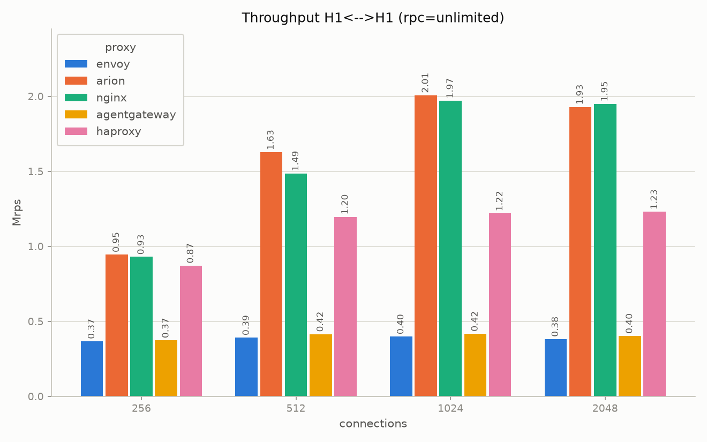
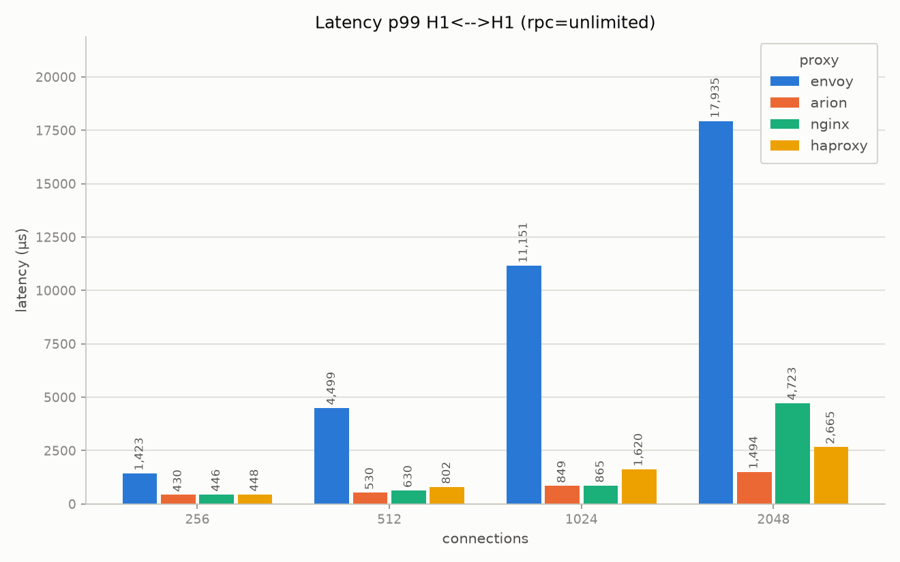

# baseline

Simple reverse proxy, without any filter. The generator sends GET requests
with empty body and the backend answers always with the same 200 response.
We test five proxies with four protocol combinations (client to proxy, then
proxy to backend):

- `h1_h1`: HTTP/1.1 -> HTTP/1.1
- `h1tls_h1`: HTTP/1.1 over TLS -> HTTP/1.1
- `h2tls_h1`: HTTP/2 over TLS -> HTTP/1.1
- `h2tls_h2tls`: HTTP/2 over TLS -> HTTP/2 over TLS

For the environment see [testbed](testbed.md). One run of 30s for each
point, with rpc in {1, 10, 100, unlimited} and concurrency in
{256, 512, 1024, 2048}.

## Peak throughput

Best rps between all the concurrency values, with `rpc: unlimited`:

| proxy | h1_h1 | h1tls_h1 | h2tls_h1 | h2tls_h2tls |
|---|---|---|---|---|
| arion | **2,007,795** | **1,734,467** | **1,291,131** | **1,151,039** |
| nginx | 1,971,981 | 1,653,242 | 1,148,635 | (see caveats) |
| haproxy | 1,229,948 | 1,164,026 | 1,167,348 | 1,129,385 |
| agentgateway | 418,018 | 405,896 | 354,572 | 329,764 |
| envoy | 398,535 | 367,544 | 330,430 | 399,654 |

- arion is the fastest in all the four combinations. nginx is very close on
  HTTP/1.1, with and without TLS (2-5% less), but when the client uses
  HTTP/2 it goes below haproxy.
- haproxy is the most stable, around 1.1-1.2M rps for every protocol. For
  this reason the difference with arion goes from 1.6x on `h1_h1` to almost
  zero on `h2tls_h2tls`.
- agentgateway and envoy are on a different level, about 0.33-0.42M rps,
  so 4-5x less than arion on HTTP/1.1.
- Adding TLS on the client side (`h1_h1` -> `h1tls_h1`) costs 14% to arion
  and 16% to nginx, but only 3-8% to the other three proxies. They are
  already slower, so the TLS cost has less impact on the total.

## Latency

p50 and p99 (µs) with concurrency 1024, `rpc: unlimited`, `h1_h1`:

| proxy | p50 | p99 |
|---|---|---|
| arion | 497 | 849 |
| nginx | 510 | 865 |
| haproxy | 809 | 1,620 |
| agentgateway | 2,283 | 4,963 |
| envoy | 1,124 | 11,151 |

arion and nginx have practically the same latency. envoy has a better
median than agentgateway, but its p99 is the worst of the five, about 2x
the one of agentgateway.

## Connection reuse

`rpc` is the maximum number of requests for each connection, so with
`rpc: 1` every request opens a new connection (and with TLS also does a
full handshake). With `rpc: 1` on `h1_h1`, arion, nginx and haproxy are all
around 0.46-0.50M rps, envoy around 0.24M and agentgateway around 0.14M.
With TLS all the proxies go down to 40-70k rps, because the handshake
becomes the limit. In this case agentgateway is the best one (69k on
`h1tls_h1`, and also the lowest p99).

## Caveats

- **nginx on `h2tls_h2tls`** gives very unstable results (from 42k to 915k
  rps, without a clear trend with the concurrency), so we do not consider it
  comparable.
- **envoy with concurrency 2048** returns 5xx errors in several runs (up to
  about 2.2M on `h1tls_h1` with `rpc: 100`), so its numbers at 2048 are not
  reliable.

The charts for the other three combinations and for every `rpc` value are
in `../results/baseline/comparison/<scenario>/`.
