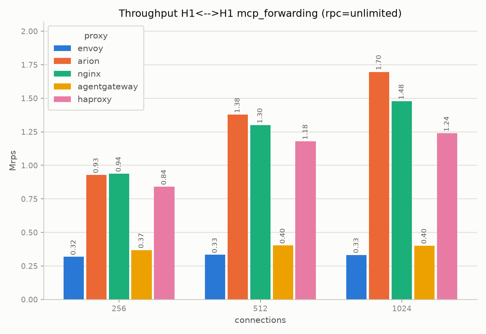
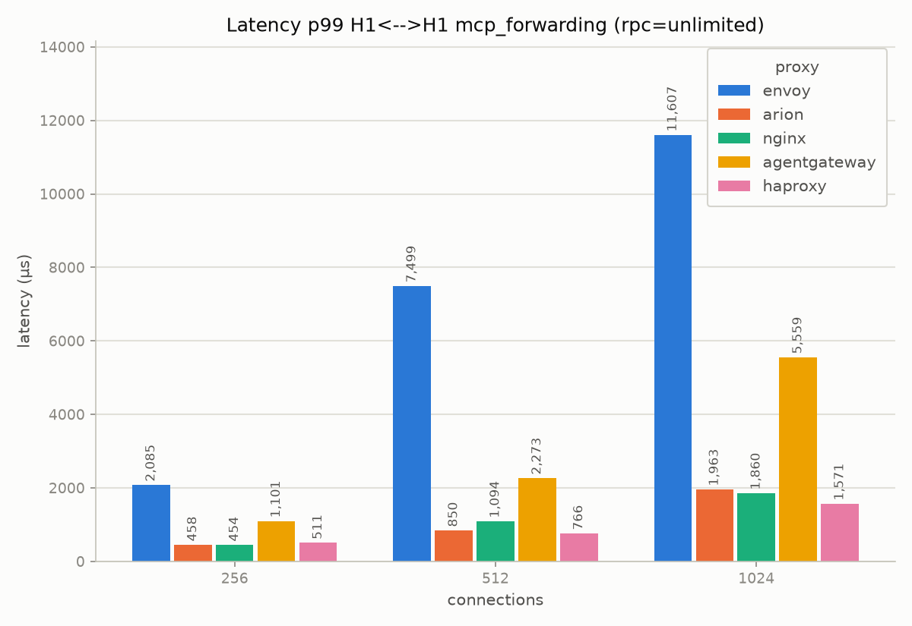

# mcp-forwarding

Simple L7 forwarding of MCP traffic, without any MCP gateway filter on the
proxy. Every proxy uses the same configuration of the baseline
(`arion-h1.yaml`, `nginx-h1.conf`, ...). Client and backend speak MCP
(statico in `--mcp-everything` mode), and the proxy only forwards the
bytes. For the environment see [testbed](testbed.md).

We test the same five proxies of the [baseline](baseline.md). One run of
30s for each point, `rpc: unlimited`, concurrency in {256, 512, 1024}.

| proxy | rps @1024 | rps @512 | rps @256 | p50 @1024 (µs) | p99 @1024 (µs) |
|---|---|---|---|---|---|
| arion | 1,696,500 | 1,377,635 | 928,821 | 549 | 1,963 |
| nginx | 1,477,989 | 1,299,750 | 938,408 | 638 | 1,860 |
| haproxy | 1,238,718 | 1,178,656 | 841,517 | 796 | 1,571 |
| agentgateway | 402,094 | 403,643 | 368,843 | 2,339 | 5,559 |
| envoy | 332,929 | 333,304 | 318,714 | 1,333 | 11,607 |

arion, nginx and haproxy have similar results (between 0.93M and 1.7M rps
at the highest concurrency), while agentgateway and envoy are 3-5x slower.

## Comparison with the HTTP baseline

The proxies and the configurations are the same of `h1_h1` in the
baseline, only the traffic is different: MCP tool calls to a backend that
does real MCP processing, instead of empty GET requests with a fixed 200
response. No proxy here reads the MCP payload, so the difference shows the
cost of the different traffic, not the cost of MCP processing in the proxy.

rps with concurrency 1024 and `rpc: unlimited`:

| proxy | baseline `h1_h1` | mcp-forwarding | delta |
|---|---|---|---|
| arion | 2,007,795 | 1,696,500 | -15.5% |
| nginx | 1,971,981 | 1,477,989 | -25.1% |
| haproxy | 1,219,156 | 1,238,718 | +1.6% |
| agentgateway | 418,018 | 402,094 | -3.8% |
| envoy | 398,535 | 332,929 | -16.5% |

- The order of the proxies does not change (arion > nginx > haproxy >>
  agentgateway > envoy). When the proxy only forwards the traffic, MCP is
  not a special problem for any of them.
- haproxy and agentgateway change very little at every concurrency. arion
  and nginx lose 15-25% at 1024, but at 256 they are less than 2% below the
  baseline. So for them the difference comes from the saturation at high
  load, and it is not a fixed cost for each request. For envoy the
  difference is more or less constant (13-17%) at all the concurrency
  values.
- These differences are small if compared with the cost of really
  interpreting MCP in the proxy, see
  [mcp-gateway-mcp-upstream](mcp-gateway-mcp-upstream.md) and
  [mcp-gateway-input-schema](mcp-gateway-input-schema.md).

