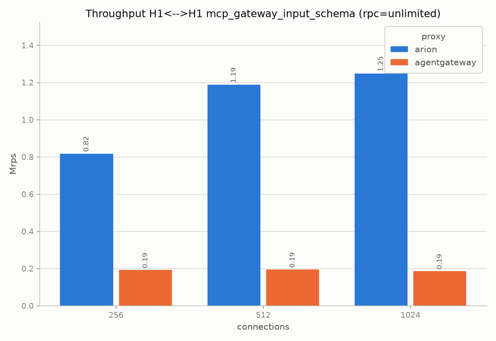
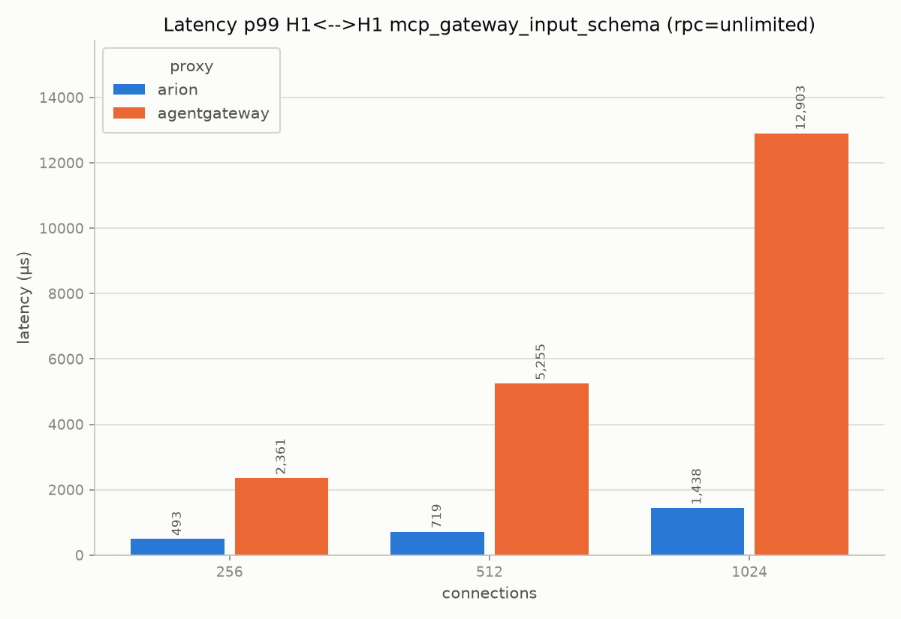

# mcp-gateway-input-schema

The MCP gateway filter translates an OpenAPI operation into an MCP tool
call. There are five strategies to decide where the arguments of the tool
come from: `body`, `path`, `query`, `path-body-query` and `input-schema`.
We use `input-schema` as the reference scenario because it has the biggest
difference between arion and agentgateway. The other four give very
similar results:

| scenario | arion rps @1024 | agentgateway rps @1024 | arion/agentgateway |
|---|---|---|---|
| body | 1,176,528 | 183,220 | 6.4x |
| path | 1,195,037 | 181,116 | 6.6x |
| query | 1,227,773 | 180,138 | 6.8x |
| path-body-query | 1,137,351 | 175,140 | 6.5x |
| **input-schema** | **1,282,709** | **186,287** | **6.9x** |

For the environment see [testbed](testbed.md). Only arion and agentgateway
have an MCP gateway filter, so they are the only two proxies tested here.

| proxy | rps @1024 | rps @512 | rps @256 | p50 @1024 (µs) | p99 @1024 (µs) |
|---|---|---|---|---|---|
| arion | 1,282,709 | 1,229,315 | 886,081 | 788 | 1,261 |
| agentgateway | 186,287 | 194,682 | 192,104 | 4,935 | 12,903 |

Both proxies are faster with `input-schema` than with `body`, `path`,
`query` and `path-body-query`, so it seems to be the cheapest of the five
mappings. arion gains more than agentgateway from it, and this is the
reason why the ratio is the highest here. In
[mcp-gateway-mcp-upstream](mcp-gateway-mcp-upstream.md) there is a
comparison of this gap with the simple [forwarding](mcp-forwarding.md) and
with a native MCP upstream.

