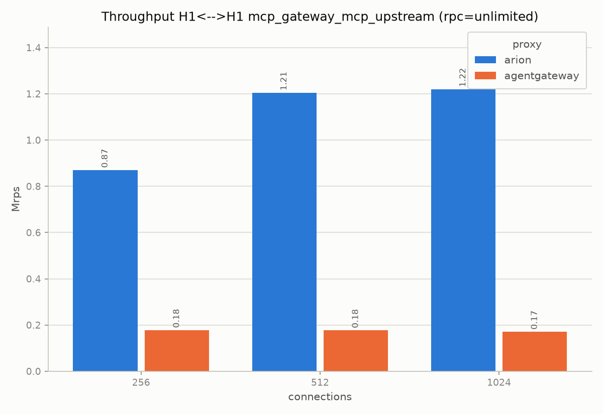
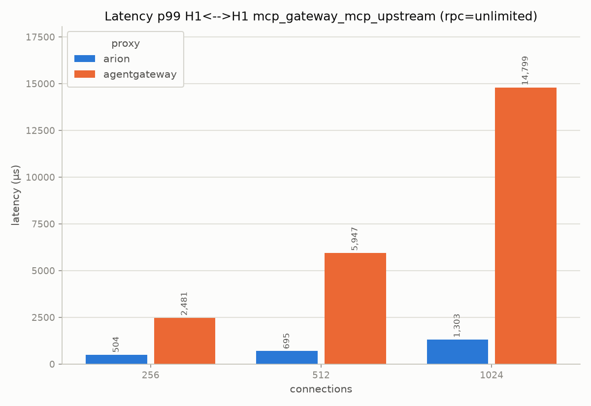

# mcp-gateway-mcp-upstream

In this scenario the MCP gateway filter is enabled, but there is nothing to
translate. The statico backend already exposes a native MCP endpoint on
`/mcp`, so arion and agentgateway only route the traffic at MCP level,
without mapping an OpenAPI call to a tool call. For the environment see
[testbed](testbed.md).

Only arion and agentgateway have an MCP gateway filter, so they are the
only two proxies tested here.

| proxy | rps @1024 | rps @512 | rps @256 | p50 @1024 (µs) | p99 @1024 (µs) |
|---|---|---|---|---|---|
| arion | 1,600,704 | 1,491,317 | 1,158,996 | 598 | 1,401 |
| agentgateway | 171,498 | 177,604 | 178,394 | 5,291 | 14,799 |

Here arion has about 9x the throughput of agentgateway. This difference is
bigger than in the simple forwarding (about 4x) and also bigger than in the
OpenAPI to MCP translation (about 7x, see
[mcp-gateway-input-schema](mcp-gateway-input-schema.md)). The two proxies
behave in the opposite way: arion is faster here than with the translation,
as expected since it has less work to do, while agentgateway is slower here
than with the translation (171k against 186k rps at 1024). So for
agentgateway the MCP-to-MCP path is the slowest one, not the OpenAPI
gateway.

| scenario | arion rps @1024 | agentgateway rps @1024 | arion/agentgateway |
|---|---|---|---|
| [mcp-forwarding](mcp-forwarding.md) (no gateway) | 1,696,500 | 402,094 | 4.2x |
| [mcp-gateway-input-schema](mcp-gateway-input-schema.md) (OpenAPI -> MCP) | 1,282,709 | 186,287 | 6.9x |
| mcp-gateway-mcp-upstream (MCP -> MCP) | 1,600,704 | 171,498 | 9.3x |

