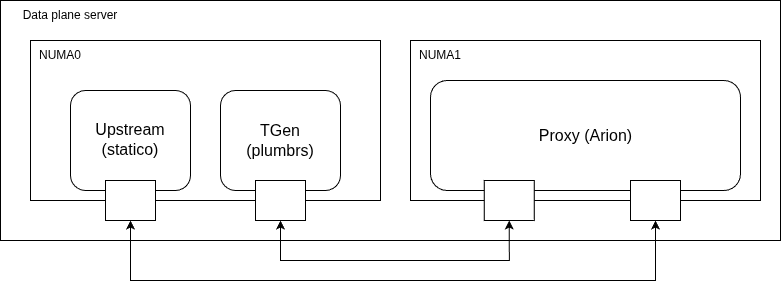

# Testbed

This page describes the environment used for all the documents in
`analysis/`, so the `baseline` and `baseline-small-scale` families and the
`mcp-forwarding`, `mcp-gateway-mcp-upstream` and `mcp-gateway-input-schema`
families. The
complete configurations are in `../proxy-configs/` and `../sweep-configs/`,
here we only collect the parts that are common to all of them.

## Hardware

All the tests run on a single server, using both NUMA nodes:

- Dell PowerEdge R750, Intel Xeon Gold 6338 @ 2.00GHz (turbo disabled),
  256 GB RAM.
- Mellanox ConnectX-5 NICs with 25 Gbps ports, connected port-to-port with
  direct cables (no switch). We use four ports in total:
  - NIC on NUMA0: one port for the generator and one for the backend.
  - NIC on NUMA1: one downstream port toward the generator and one upstream
    port toward the backend.

The path of a request is generator -> (NUMA0 port, cable, NUMA1 port) ->
proxy -> (NUMA1 port, cable, NUMA0 port) -> backend. In this way every
request passes two times on a real cable, and the proxy is never on the same
NUMA node of the generator or the backend.

## Roles

| role | NUMA node | address | what runs there |
|---|---|---|---|
| generator | 0 | (host namespace) | `plumbrs`, the HTTP/MCP load generator |
| proxy | 1 | 192.168.100.1 | the proxy under test, in a dedicated `proxy` network namespace |
| backend | 0 | 192.168.200.2 | `statico`, a static-file and MCP backend |

## Cores

The logical CPUs are interleaved between the two NUMA nodes: the even ones
are on NUMA0 and the odd ones on NUMA1.

The proxy under test is pinned on the 32 CPUs of NUMA1
(`taskset -c 1-63:2`), and its number of workers/threads is the same as the
number of CPUs: `num_cpus`/`num_runtimes` for arion, `worker_processes` and
`worker_cpu_affinity` for nginx, `nbthread` and `cpu-map` for haproxy. envoy
and agentgateway have no explicit thread count in the configuration, they
take it automatically from the taskset mask.

Generator and backend use the 32 CPUs of NUMA0, divided in two equal parts
without overlap: the generator on `0-30:2` and the backend on `32-62:2`,
both with 16 threads.

The `baseline-small-scale` family is the only exception: the proxy has only
4 CPUs (`1-7:2`), the generator uses `16-38:2` and the backend `40-62:2`,
both with 12 threads. In this family the IRQs of the NUMA1 NIC are pinned
on the same 4 CPUs of the proxy. See
[baseline-small-scale](baseline-small-scale.md).

## Software

| component | binary | notes |
|---|---|---|
| arion | built from source, `release-max` profile | |
| envoy | 1.37.1 | |
| nginx | 1.31.4 | |
| haproxy | system package | needs 2.6 or newer (`shards by-thread`, new `cpu-map` syntax) |
| agentgateway | built from source, `release` profile | |
| generator | `plumbrs`, 16 threads | custom HTTP/MCP load generator, reports latency percentiles in CSV |
| backend | `statico`, 16 threads | custom static-file server, with `--mcp-everything` it works as a native MCP server |

## Method

Every point of a sweep is one single run of 30 seconds (`duration: 30`,
`repeat: 1`) with fixed concurrency and fixed limit of requests per
connection (`rpc`). The MCP families are tested only with
`rpc: unlimited`.

## Reproducibility

The configurations in this repository are a simplified version of the ones
used for the original runs. In the original testbed NUMA1 was divided in 24
cores for the proxy and 8 cores reserved for the IRQ handling of the NICs,
and also the number of threads of generator and backend was a bit
different. Here we replaced this with a simple pinning of 32 cores for the
proxy and a clean division of NUMA0 between generator and backend, so it is
easier to reproduce the tests on a similar machine with two NUMA nodes. A
re-run should give results in the same range of the published ones, but not
exactly the same numbers.
